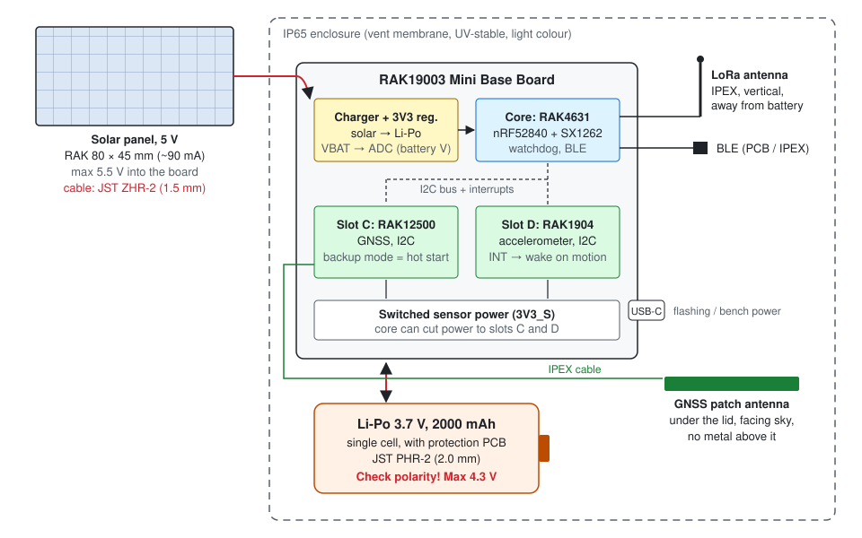
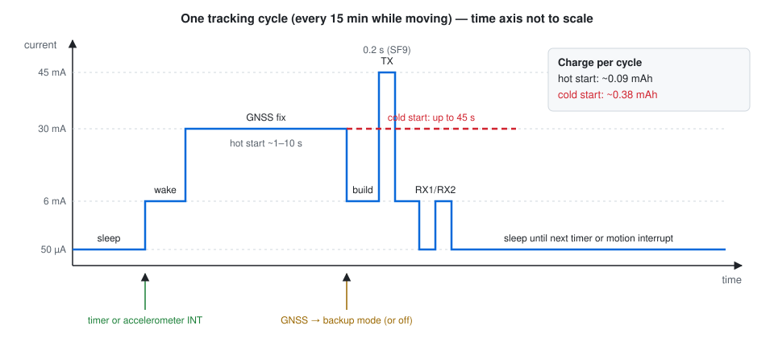
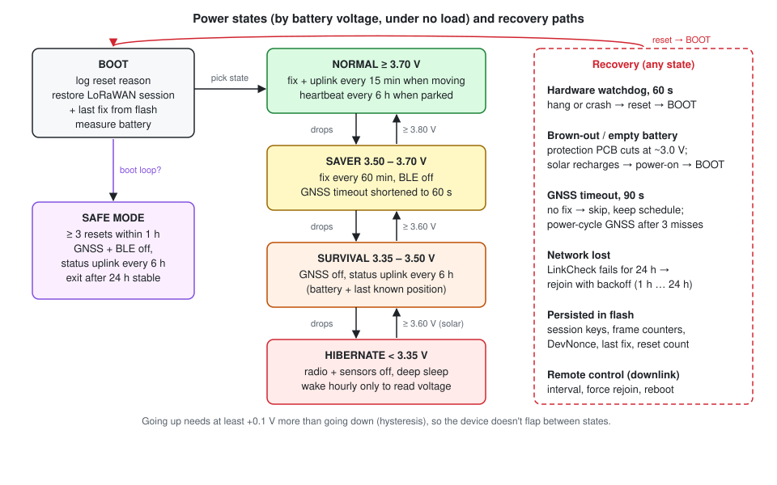

# Autonomous, self-healing setup

Goal: a tracker that runs **at least 30 days on battery alone**, keeps going indefinitely with a small solar panel,
and recovers by itself from crashes, empty batteries and lost network, without anyone touching it.

**Summary**
- **Battery:** 2000 mAh single-cell Li-Po with a protection circuit. That's 30+ days with no sun even in the worst case, and about 4.5 months in the normal case.
- **Solar:** RAK's 5 V 80 × 45 mm panel (~90 mA) is enough in most places. Use the 140 × 90 mm panel (~380 mA) for shade, high latitudes in winter, or if the GNSS cold-starts on every fix.
- **Biggest lever:** keep the GNSS in backup mode between fixes so it hot-starts. Cold starts make it use almost 4× more power.

## 1. Wiring and enclosure

Notes:
- **Battery connector:** JST PHR-2 (2.0 mm), max 4.3 V. **Polarity of JST battery cables is not standard:** check the + marking on the board against the cable before plugging in. Reversed polarity can kill the battery input.
- **Solar connector:** JST ZHR-2 (1.5 mm). Only 5 V panels; keep the input at or below 5.5 V. Use RAK's own panels: a generic "5 V" panel can have a much higher open-circuit voltage.
- **GNSS antenna:** under the lid, facing the sky, with nothing metal above it.
- **LoRa antenna:** vertical, and away from the battery.
- **Enclosure:** IP65 with a breathable vent membrane against condensation. A light colour keeps the battery cooler in the sun.
- **Temperature:** Li-Po must not be charged below 0 °C or above 45 °C. The base board's charger has no temperature cutoff, so for winter deployments below freezing, insulate the battery or choose a pack with low-temperature charge protection.

## 2. One tracking cycle

The device spends almost all its time asleep. It wakes on a timer, or when the accelerometer detects movement.
It gets a fix, sends one uplink (10 bytes, see [payload.md](payload.md)), listens for the two receive windows, and goes back to sleep.

## 3. Power budget

Assumptions (conservative):

| Item | Current | Time | Source |
|---|---|---|---|
| Whole board asleep | 50 µA | rest of the time | RAK4631 datasheet says 2 µA; forum users measure 25 µA+ on a base board, so this leaves margin |
| GNSS backup mode | 15 µA | always (hot-start case) | RAK12500 datasheet |
| GNSS fix + MCU | 30 mA | 10 s hot / 45 s cold | RAK12500 acquisition ~22–25 mA, cold start up to 45 s |
| LoRa TX at 14 dBm | 45 mA | 0.2 s (SF9) | SX1262, airtime from [payload.md](payload.md) |
| RX windows | 6 mA | 0.4 s | two windows, no downlink |
| MCU awake | 5 mA | 2 s | wake, read sensors, build payload |

Per day:

| Scenario | mAh/day | 30 days | Battery needed (70% usable) | 2000 mAh lasts |
|---|---|---|---|---|
| **Design:** moving all day, fix every 15 min, GNSS hot start | 10.1 | 304 mAh | 434 mAh | ~138 days |
| **Worst:** same, but GNSS cold start every fix | 37.8 | 1133 mAh | 1619 mAh | ~37 days |
| Worst, 22 dBm TX (AS923 / US915) | 38.2 | 1146 mAh | 1637 mAh | ~37 days |
| **Parked:** status every 6 h, wakes on motion | 2.7 | 82 mAh | 117 mAh | over a year |

"70% usable" accounts for stopping at 3.35 V (see below), cold, and battery ageing.

GNSS time dominates every scenario: it's 80–95% of the daily total. Two things to check on the bench:
- **Does cutting slot power also cut the GNSS backup supply?** If it does, turning slot power off forces cold starts. Use the module's own backup/sleep command instead.
- **The real sleep current:** measure it with a power profiler, and update this table.

## 4. Solar sizing

Charge into the battery ≈ panel current × peak sun hours × 0.7 (angle, dirt, heat, charger losses):

| Panel | 1 peak sun h/day (dark winter) | 2 h | 4 h |
|---|---|---|---|
| RAK 80 × 45 mm, ~90 mA | ~63 mAh | ~126 mAh | ~252 mAh |
| RAK 140 × 90 mm, ~380 mA | ~266 mAh | ~532 mAh | ~1064 mAh |

- The small panel covers even the worst case (38 mAh/day) with just one peak sun hour per day.
- The battery covers the gaps: with no sun at all, 2000 mAh lasts about 4.5 months in the design case and about 5 weeks in the worst case.
- Mount the panel tilted toward the equator (at roughly your latitude), clear of shade around midday.

## 5. Self-healing behaviour

**Power states** are picked from the battery voltage, measured with the radio idle:

| State | Battery | Behaviour |
|---|---|---|
| NORMAL | ≥ 3.70 V | fix every 15 min when moving, status every 6 h when parked |
| SAVER | 3.50–3.70 V | fix every 60 min, BLE off, shorter GNSS timeout |
| SURVIVAL | 3.35–3.50 V | GNSS off, status uplink every 6 h |
| HIBERNATE | < 3.35 V | everything off; wake hourly only to read the voltage |

Going up needs at least 0.1 V more than going down, so the device doesn't flap between states.
It leaves HIBERNATE at 3.60 V, so the solar panel has to put some real charge back first.

**Recovery paths:**
- **Hardware watchdog (nRF52, 60 s):** any hang resets the board.
- **Brown-out:** if the battery really empties, its protection circuit cuts at about 3.0 V. When solar brings it back, the board powers on and boots normally.
- **Boot loop protection:** 3 or more resets within an hour → SAFE MODE (GNSS and BLE off, status every 6 h) until 24 h without a reset.
- **GNSS timeout (90 s):** no fix → skip this cycle and keep the schedule. Power-cycle the GNSS after 3 misses in a row.
- **Network lost:** if LoRaWAN link checks fail for 24 h, rejoin with backoff (1 h, doubling up to 24 h). This doesn't drain the battery where there's no coverage.
- **Persist across resets (flash):** LoRaWAN session keys, frame counters and DevNonce (so a reset doesn't force a rejoin or get frames rejected), last fix, reset count.
- **Remote control by downlink:** change the interval, force a rejoin, reboot. Keep under TTN's 10 downlinks a day.

> The status uplink (battery, state, reset reason, last known position) is not in payload format v1 yet.
> It needs a second FPort and a decoder update.

## Sources
- RAK19007 / RAK19003 battery and solar limits: [RAK19007 datasheet](https://docs.rakwireless.com/product-categories/wisblock/rak19007/datasheet/), [RAK19007 installation guide](https://docs.rakwireless.com/product-categories/wisblock/rak19007/installation-guide/), [RAK19003 datasheet](https://docs.rakwireless.com/product-categories/wisblock/rak19003/datasheet/)
- Battery polarity: [RAK forum](https://forum.rakwireless.com/t/battery-polarity-wisblock-starter-kit-rak4631-rak19007/11486)
- Sleep current: [RAK4631 datasheet](https://docs.rakwireless.com/product-categories/wisblock/rak4631/datasheet/), [RAK forum: RAK4631 power consumption](https://forum.rakwireless.com/t/rak4631-power-consumption/10259)
- Solar panels: [RAK 80 × 45 mm panel datasheet](https://docs.rakwireless.com/product-categories/accessories/solar-panel-80x45/datasheet/), [RAK 140 × 90 mm panel](https://store.rokland.com/products/rakwireless-solar-panel-with-jst-1-5-connector-large-5-5-x-3-5-inch-sku-920433)
- GNSS figures: [RAK12500 datasheet](https://docs.rakwireless.com/product-categories/wisblock/rak12500/datasheet/), [RAK12501 comparison](https://store.rakwireless.com/products/wisblock-rak12501-gnss-module)
